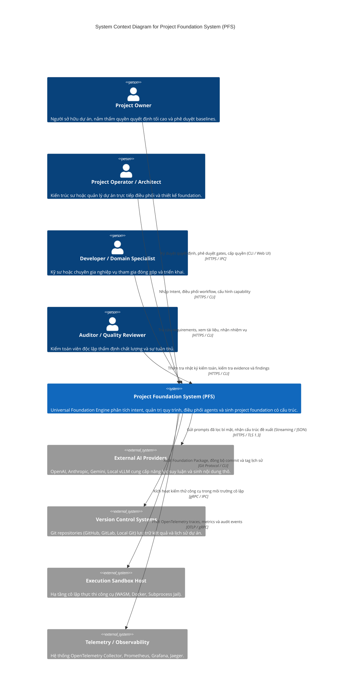

# PFS-M1-DOC-005 — System Context and Stakeholder Concerns

| Thuộc tính | Giá trị |
|---|---|
| Document ID | PFS-M1-DOC-005 |
| Document Title | System Context and Stakeholder Concerns Specification |
| Project | Project Foundation System (PFS) |
| Milestone | M1 — Documentation & Architecture Foundation |
| Version | 1.0.0 |
| Status | Proposed — Ready for Owner Review |
| Authority | Principal Systems Architect |
| Classification | Internal |
| Reference Architecture | C4 Model — System Context (Level 1) |
| Related Diagrams | DIA-001-system-context.mmd |
| Related Documents | PFS-M1-DOC-002, PFS-M1-DOC-004 |

---

## 1. System Context Diagram (C4 Level 1)

Sơ đồ ngữ cảnh hệ thống (System Context) mô tả vị trí trung tâm của **Project Foundation System (PFS)**, xác định rõ ranh giới tương tác giữa PFS với con người (Users) và các hệ thống ngoại vi (External Systems):

---

## 2. External Actors and Interactions

### 2.1. Tác nhân Con người (Human Actors)

1. **Project Owner:**
   - **Vai trò:** Người chịu trách nhiệm cao nhất về pháp lý, ngân sách và định hướng chiến lược của dự án.
   - **Tương tác:** Tiếp nhận các thông báo yêu cầu phê duyệt (Approval Requests), xem xét các quyết định kiến trúc chiến lược (ADRs), cấp phát ngân sách token và ký duyệt nghiệm thu Milestone Baseline (L5 Authority).
2. **Project Operator / Systems Architect:**
   - **Vai trò:** Người trực tiếp vận hành hệ thống PFS để thiết lập Foundation cho một dự án cụ thể.
   - **Tương tác:** Nhập Project Intent ban đầu, lựa chọn Project Profile, kích hoạt các workflow stages, cấu hình phân quyền cho Agent và giải quyết các xung đột kỹ thuật (L3–L4 Authority).
3. **Developer / Domain Specialist:**
   - **Vai trò:** Người tiếp nhận Foundation Package sau khi được sinh ra để triển khai công việc thực tế (lập trình, phân tích thị trường, nghiên cứu).
   - **Tương tác:** Khám phá cấu trúc dự án, tra cứu yêu cầu nghiệp vụ, cập nhật trạng thái nhiệm vụ và đóng góp tài liệu chuyên môn (L0–L2 Authority).
4. **Independent Quality Auditor:**
   - **Vai trò:** Chuyên gia độc lập kiểm toán chất lượng và tính tuân thủ quy chuẩn của Foundation trước khi đưa vào sản xuất.
   - **Tương tác:** Rà soát toàn bộ chuỗi truy vết (Traceability DAG), thẩm tra tính toàn vẹn của bằng chứng (Evidence), ghi nhận phát hiện (Findings) và ký xác nhận báo cáo kiểm toán (Audit Verification Authority).

### 2.2. Hệ thống Ngoại vi (External Systems)

1. **External AI Model Providers:**
   - Các dịch vụ LLM công cộng (OpenAI API, Anthropic Claude API, Google Gemini API) hoặc máy chủ mã nguồn mở nội bộ (Ollama, vLLM).
   - **Giao thức:** HTTPS REST API, JSON Structured Outputs, Server-Sent Events (SSE) cho streaming.
   - **Ràng buộc an ninh:** Tuyệt đối không gửi thông tin định danh bí mật, credentials hoặc dữ liệu phân loại Restricted sang các hệ thống này.
2. **Version Control Systems (VCS):**
   - Nơi lưu trữ mã nguồn và tài liệu của dự án đích (GitHub, GitLab hoặc Local Git Repository).
   - **Giao thức:** Git CLI subprocess hoặc Git lib2 git binding.
   - **Ràng buộc an ninh:** PFS chỉ thực hiện các thao tác trong thư mục làm việc được ủy quyền rõ ràng; tuyệt đối không thực hiện commit/push ra remote nếu không có lệnh trực tiếp từ người dùng.
3. **Execution Sandbox Host:**
   - Môi trường cô lập dùng để thực thi các công cụ ngoại vi (linters, formatters, schema validators, code compilers) do Agent đề xuất.
   - **Giao thức:** gRPC qua Unix Domain Socket / Named Pipes.
   - **Ràng buộc an ninh:** Không cấp quyền truy cập mạng mặc định; giới hạn tối đa tài nguyên CPU, RAM và hệ thống tập tin (Read-only root, ephemeral tmpfs).
4. **Enterprise Observability & Telemetry Platform:**
   - Hạ tầng giám sát tập trung (Prometheus, Grafana Loki, Jaeger, Datadog).
   - **Giao thức:** OpenTelemetry Protocol (OTLP/gRPC).
   - **Dữ liệu truyền tải:** Traces, Spans, Metrics về độ trễ, số lượng token tiêu thụ và các sự kiện kiểm toán nghiệp vụ (Audit Trail).

---

## 3. Detailed Stakeholder Concerns Analysis

Hệ thống kiến trúc PFS được tối ưu hóa để giải quyết triệt để các mối bận tâm chuyên sâu của từng nhóm đối tượng:

| Stakeholder | Mối bận tâm cốt lõi (Core Concerns) | Giải pháp Kiến trúc PFS đáp ứng |
|---|---|---|
| **Project Owner** | 1. Sợ AI tự ý sinh mã/tài liệu sai lệch định hướng. 2. Sợ bị phụ thuộc vào một công ty AI (Vendor lock-in). 3. Mất kiểm soát chi phí API token. | - Cơ chế Human-in-the-Loop bắt buộc ký duyệt L3–L5. - Gateway trừu tượng hóa cho phép đổi model trong 1 click. - Hạn mức ngân sách token (Token Budgeting) theo từng task. |
| **Project Operator** | 1. Quy trình rườm rà, khó theo dõi tiến độ. 2. Xung đột giữa các yêu cầu và quyết định. 3. Khó khôi phục khi tiến trình gặp sự cố. | - Workflow State Machine 11 giai đoạn tự động hóa. - Phát hiện xung đột yêu cầu tự động qua đồ thị DAG. - Lưu vết trạng thái Saga và hỗ trợ rollback nguyên tử. |
| **Developer** | 1. Tài liệu sinh ra mơ hồ, không thực tế. 2. Cấu trúc thư mục lộn xộn, ghi đè file có sẵn. 3. Thiếu công cụ kiểm tra tự động. | - Template có kiểm định schema chặt chẽ. - Dry-run preview và Ownership manifest bảo vệ file có sẵn. - CLI tích hợp bộ kiểm tra xác định (Deterministic Validator). |
| **Security Reviewer** | 1. Prompt Injection làm lộ dữ liệu dự án. 2. Agent chiếm quyền điều khiển máy chủ (Confused Deputy). 3. Tệp tin độc hại xâm nhập vào foundation. | - Ranh giới tin cậy 4 cấp, bộ lọc Secret Redaction tự động. - Mô hình Least Privilege L0–L5 và Deny-by-Default. - Sandbox cô lập thực thi và kiểm định mã băm SHA-256. |
| **Quality Auditor** | 1. Thiếu bằng chứng chứng minh chất lượng. 2. Không truy vết được nguồn gốc tài liệu. 3. Đánh đồng điểm trung bình với lỗi nghiêm trọng. | - Yêu cầu bằng chứng độc lập cho từng tiêu chí. - Cây Merkle DAG truy vết nguồn gốc (Provenance) bất biến. - Cổng chất lượng nghiêm ngặt: 1 lỗi Critical là chặn xuất bản. |
