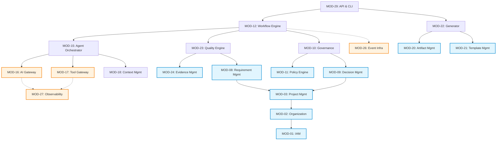

# PFS-M1-DOC-012 — Module Catalog and Dependency Architecture

| Thuộc tính | Giá trị |
|---|---|
| Document ID | PFS-M1-DOC-012 |
| Document Title | Comprehensive Module Catalog and Dependency Architecture Specification |
| Project | Project Foundation System (PFS) |
| Milestone | M1 — Documentation & Architecture Foundation |
| Version | 1.0.0 |
| Status | Proposed — Ready for Owner Review |
| Authority | Principal Systems Architect |
| Classification | Internal |
| Reference Architecture | Modular Monolith, Component Catalog, Acyclic Dependency Graph |
| Related Diagrams | DIA-004-c4-component.mmd, DIA-005-dependency-graph.mmd |
| Related Decisions | ADR-001, ADR-002, ADR-003 |

---

## 1. Modular Architecture Strategy & Rules

Hệ thống **Project Foundation System (PFS)** được tổ chức dưới hình thái **Modular Monolith** bằng ngôn ngữ Rust. Toàn bộ 29 phân hệ nghiệp vụ được mô đun hóa nghiêm ngặt, đóng gói thành các crates độc lập hoặc modules nội bộ có ranh giới rõ ràng.

### 1.1. Các quy tắc phụ thuộc bất biến (Invariant Dependency Rules)
1. **Rule 1 — Zero Circular Dependencies:** Tuyệt đối cấm mọi quan hệ phụ thuộc chu trình (Cyclic Dependencies) ở cấp độ Crate, Module và Trait. Thuật toán kiểm tra đồ thị chu trình (Tarjan/DFS) được tích hợp trong công cụ kiểm định tự động.
2. **Rule 2 — Strict Dependency Inversion:** Các module tầng Core Domain (Entities, Aggregates) không được phép phụ thuộc vào bất kỳ module nào thuộc tầng Infrastructure, Adapters hoặc External SDKs.
3. **Rule 3 — Public Contract Visibility:** Module A chỉ được phép gọi vào Module B thông qua các Trait interfaces công khai (`pub trait`) hoặc các Command/Query Structs được định nghĩa tại `contracts`. Mọi cấu trúc dữ liệu nội bộ (`pub(crate)`) của Module B đều bị ẩn hoàn toàn.
4. **Rule 4 — Explicit Data Ownership:** Mỗi bảng cơ sở dữ liệu và mỗi thư mục trạng thái trên ổ đĩa chỉ thuộc quyền sở hữu duy nhất của MỘT module. Các modules khác muốn truy cập bắt buộc phải thông qua Query Service hoặc Domain Events.

---

## 2. Complete Module Catalog (29 Canonical Modules)

Dưới đây là danh mục và đặc tả toàn diện của toàn bộ 29 modules cốt lõi trong hệ thống PFS:

```
┌─────────────────────────────────────────────────────────────────────────────┐
│                       Comprehensive Module Topology                         │
├─────────────────────────────────────────────────────────────────────────────┤
│ Identity & Core Tenancy  : MOD-01-IAM, MOD-02-ORG, MOD-03-PRJ              │
│ Domain Intent & Config   : MOD-04-INT, MOD-05-PRF, MOD-06-CAP              │
│ Requirements & Governance: MOD-07-FND, MOD-08-REQ, MOD-09-DEC, MOD-10-GOV, │
│                            MOD-11-POL                                       │
│ Workflow & Orchestration : MOD-12-WKF, MOD-13-TSK, MOD-14-AGT, MOD-15-ORC  │
│ AI & Tool Adapters       : MOD-16-GWY, MOD-17-TOL, MOD-18-CTX, MOD-19-KNW  │
│ Artifacts & Generation   : MOD-20-ART, MOD-21-TPL, MOD-22-GEN              │
│ Quality & Assurance      : MOD-23-QLT, MOD-24-EVI, MOD-25-VER              │
│ Infrastructure & Platform: MOD-26-EVT, MOD-27-AUD, MOD-28-IO, MOD-29-INTG │
└─────────────────────────────────────────────────────────────────────────────┘
```

### MOD-01: Identity and Access Management (`pfs-iam`)
- **Mục đích:** Xác thực danh tính chủ thể (User, Service, Agent) và cấp phát bảo mật phiên làm việc.
- **Trách nhiệm:** Quản lý User accounts, API keys, JWT sessions, xác thực chữ ký Ed25519.
- **Không đảm nhiệm:** Không thực thi chính sách phân quyền L0–L5 (do MOD-11-POL đảm nhiệm).
- **Domain Concepts:** `Principal`, `SessionToken`, `CredentialKey`.
- **Phụ thuộc:** `pfs-core`. **Cấm phụ thuộc:** `pfs-ui`, `pfs-generator`.

### MOD-02: Organization and Workspace Management (`pfs-org`)
- **Mục đích:** Quản lý cấu trúc phân cấp đa khách thuê (Multi-Tenancy) và cách ly phạm vi (Scope Isolation).
- **Trách nhiệm:** Quản lý vòng đời Organization và Workspace; phân bổ hạn ngạch tài nguyên.
- **Domain Concepts:** `Organization`, `Workspace`, `TenantQuota`.

### MOD-03: Project Management (`pfs-project`)
- **Mục đích:** Quản lý thực thể trung tâm Project và vòng đời tổng thể của dự án.
- **Trách nhiệm:** Khởi tạo dự án, phân loại trạng thái, quản trị quyền sở hữu dự án.
- **Domain Concepts:** `Project`, `ProjectStatus`, `ProjectHierarchy`.

### MOD-04: Project Intent Management (`pfs-intent`)
- **Mục đích:** Tiếp nhận, phân tích cú pháp và chuẩn hóa Project Intent ban đầu.
- **Trách nhiệm:** Trích xuất mục tiêu, phạm vi sơ bộ, phân tích ngôn ngữ tự nhiên từ brief.
- **Domain Concepts:** `ProjectIntent`, `RawBrief`, `ClarificationQuestion`.

### MOD-05: Project Profile Engine (`pfs-profile`)
- **Mục đích:** Xây dựng và quản lý hồ sơ kỹ thuật, bối cảnh và ràng buộc của dự án.
- **Trách nhiệm:** Xác định Domain type (Software, Business, Research, Custom), rủi ro, phân loại bảo mật.
- **Domain Concepts:** `ProjectProfile`, `ProjectContext`, `RiskAppetite`.

### MOD-06: Capability Registry (`pfs-capability`)
- **Mục đích:** Quản lý danh mục năng lực và giải quyết đồ thị phụ thuộc giữa các capabilities.
- **Trách nhiệm:** Kiểm tra tính phụ thuộc, loại trừ xung đột, xác thực lý do Not Applicable.
- **Domain Concepts:** `Capability`, `CapabilityCatalog`, `ResolvedCapabilitySet`.

### MOD-07: Foundation Management (`pfs-foundation`)
- **Mục đích:** Đại diện cho thực thể tổng thể Foundation Package và trạng thái 11 giai đoạn.
- **Trách nhiệm:** Gắn kết các artifacts, phiên bản phát hành và niêm phong baseline.
- **Domain Concepts:** `Foundation`, `FoundationStageBinding`, `FoundationRelease`.

### MOD-08: Requirement Management (`pfs-requirement`)
- **Mục đích:** Xây dựng và duy trì mạng lưới Directed Acyclic Graph (DAG) của Requirements.
- **Trách nhiệm:** Phân loại yêu cầu (FR, NFR, Constraint, Assumption), phát hiện chu trình, kiểm tra xung đột.
- **Domain Concepts:** `Requirement`, `Constraint`, `Assumption`, `Risk`.

### MOD-09: Decision Management (`pfs-decision`)
- **Mục đích:** Quản lý hồ sơ các quyết định kiến trúc chiến lược (ADRs).
- **Trách nhiệm:** Ghi nhận lý do, các phương án lựa chọn, quan hệ thay thế (supersession).
- **Domain Concepts:** `ArchitectureDecision`, `DecisionStatus`, `SupersessionEdge`.

### MOD-10: Governance Management (`pfs-governance`)
- **Mục đích:** Định nghĩa vai trò, thẩm quyền và quy trình phê duyệt (Approval Workflows).
- **Trách nhiệm:** Quản lý ma trận phân quyền, yêu cầu ký duyệt đa cấp, xử lý ngoại lệ (Waivers).
- **Domain Concepts:** `Role`, `Authority`, `ApprovalRequest`, `ExceptionWaiver`.

### MOD-11: Policy Engine (`pfs-policy`)
- **Mục đích:** Động cơ đánh giá phân quyền L0–L5 và kiểm soát tuân thủ quy tắc xác định.
- **Trách nhiệm:** Đánh giá Deny-by-default, Least Privilege, kiểm tra thẩm quyền trước mỗi Command.
- **Domain Concepts:** `PolicyRule`, `AuthorizationGrant`, `PolicyEvaluationResult`.

### MOD-12: Workflow Engine (`pfs-workflow`)
- **Mục đích:** Điều phối Finite State Machine của 11 giai đoạn vòng đời và saga orchestration.
- **Trách nhiệm:** Quản lý trạng thái, chuyển đổi giai đoạn, kiểm tra Guards, xử lý bồi hoàn lỗi.
- **Domain Concepts:** `StageStateMachine`, `WorkflowExecution`, `TransitionGuard`.

### MOD-13: Task Management (`pfs-task`)
- **Mục đích:** Quản lý đơn vị công việc chi tiết được phân bổ cho Agent hoặc con người.
- **Trách nhiệm:** Cấp quyền thuê tác vụ (Task Lease), kiểm tra timeout, lưu trữ kết quả thực thi.
- **Domain Concepts:** `Task`, `TaskContract`, `TaskLease`, `ExecutionResult`.

### MOD-14: Agent Registry (`pfs-agent-registry`)
- **Mục đích:** Quản lý hồ sơ định danh và năng lực của các AI Agents trong hệ thống.
- **Trách nhiệm:** Đăng ký Agent Profiles, cấu hình vai trò, giới hạn công cụ được phép (Allowlist).
- **Domain Concepts:** `AgentProfile`, `AgentRoleBinding`, `AgentBudget`.

### MOD-15: Agent Orchestrator (`pfs-agent-orchestrator`)
- **Mục đích:** Lập kế hoạch phân rã nhiệm vụ (Task Planning) và định tuyến Agent tối ưu.
- **Trách nhiệm:** Định tuyến task theo năng lực, giải quyết bất đồng quan điểm giữa các agents.
- **Domain Concepts:** `PlanDAG`, `RoutingRule`, `DisagreementRecord`.

### MOD-16: AI Provider Gateway (`pfs-provider-gateway`)
- **Mục đích:** Cung cấp lớp trừu tượng hóa thống nhất kết nối đến các nhà cung cấp LLM bên ngoài.
- **Trách nhiệm:** Chuyển đổi định dạng prompt/response, streaming, token budgeting, circuit breaker, fallback.
- **Domain Concepts:** `LLMRequest`, `LLMResponse`, `ProviderFailoverPolicy`.

### MOD-17: Tool Gateway & Sandbox (`pfs-tool-gateway`)
- **Mục đích:** Quản lý và thực thi các công cụ ngoại vi trong môi trường cách ly an toàn.
- **Trách nhiệm:** Sandbox execution (WASM/Container), lọc path traversal, ngăn chặn thực thi mã độc.
- **Domain Concepts:** `ToolDefinition`, `SandboxIsolationPolicy`, `ExecutionTelemetry`.

### MOD-18: Context Management (`pfs-context`)
- **Mục đích:** Xây dựng, lọc và tiêm ngữ cảnh (Context Injection) tối ưu cho Agent.
- **Trách nhiệm:** Thu gọn ngữ cảnh, kiểm tra tính thời sự (stale check), lọc dữ liệu mật (Secret Redaction).
- **Domain Concepts:** `ContextWindow`, `RedactedSnippet`, `RelevanceScore`.

### MOD-19: Knowledge Management (`pfs-knowledge`)
- **Mục đích:** Quản lý và cung cấp tri thức nghiệp vụ có thể tái sử dụng xuyên dự án.
- **Trách nhiệm:** Lập chỉ mục ngữ nghĩa, quản trị bản quyền và cách ly phạm vi tri thức.
- **Domain Concepts:** `KnowledgeItem`, `KnowledgeNamespace`, `SemanticVector`.

### MOD-20: Artifact Management (`pfs-artifact`)
- **Mục đích:** Quản lý kho tạo tác Content-Addressed Storage (CAS) và cây phả hệ Merkle DAG.
- **Trách nhiệm:** Lưu trữ metadata, tính mã băm SHA-256, kiểm tra tính toàn vẹn và phân loại dữ liệu.
- **Domain Concepts:** `Artifact`, `ArtifactVersion`, `MerkleNode`, `ContentBlob`.

### MOD-21: Template Management (`pfs-template`)
- **Mục đích:** Quản lý thư viện mẫu chuẩn hóa dùng cho việc sinh tài liệu và cấu trúc.
- **Trách nhiệm:** Kiểm định cú pháp template, quản lý phiên bản template, giải quyết biến (bindings).
- **Domain Concepts:** `Template`, `TemplateVersion`, `VariableBindingSchema`.

### MOD-22: Foundation Generator (`pfs-generator`)
- **Mục đích:** Động cơ sinh cấu trúc thư mục và tệp tin dự án thực tế có tính xác định và an toàn.
- **Trách nhiệm:** Quy trình 4 bước (Staging, Dry-run Preview, Conflict Detection, Atomic Commit).
- **Domain Concepts:** `GenerationPlan`, `StagedTree`, `OwnershipManifest`, `RollbackJournal`.

### MOD-23: Quality Engine (`pfs-quality`)
- **Mục đích:** Quản lý và thực thi các cổng chất lượng (Quality Gates) xác định.
- **Trách nhiệm:** Đánh giá tiêu chí đạt/không đạt, quản lý danh sách vi phạm (Findings, Defects).
- **Domain Concepts:** `QualityGate`, `GateEvaluationResult`, `Finding`.

### MOD-24: Evidence Management (`pfs-evidence`)
- **Mục đích:** Thu thập, niêm phong và xác thực bằng chứng kiểm chứng độc lập.
- **Trách nhiệm:** Kiểm tra chữ ký số bằng chứng, liên kết bằng chứng với yêu cầu và cổng chất lượng.
- **Domain Concepts:** `EvidenceRecord`, `EvidenceAttestation`, `ProofDigest`.

### MOD-25: Version and Compatibility Management (`pfs-versioning`)
- **Mục đích:** Quản lý tính tương thích phiên bản của toàn bộ các thực thể trong hệ thống.
- **Trách nhiệm:** Kiểm tra ma trận tương thích (Compatibility Matrix), cảnh báo deprecation, migration scripts.
- **Domain Concepts:** `SemVerRecord`, `CompatibilityRule`, `MigrationPlan`.

### MOD-26: Event and Job Infrastructure (`pfs-event-job`)
- **Mục đích:** Cung cấp hạ tầng phát và lắng nghe sự kiện bất đồng bộ và lập lịch tác vụ nền.
- **Trách nhiệm:** In-memory message bus, Outbox pattern, Job queue, Retry scheduler.
- **Domain Concepts:** `DomainEventEnvelope`, `JobDescriptor`, `OutboxMessage`.

### MOD-27: Audit and Observability (`pfs-observability`)
- **Mục đích:** Thu thập viễn trắc (OpenTelemetry), nhật ký có cấu trúc và sổ cái kiểm toán bất biến.
- **Trách nhiệm:** Xuất OTLP traces, metrics, phân bổ Correlation IDs, lưu trữ Audit Ledger (Append-only).
- **Domain Concepts:** `AuditEntry`, `TraceSpan`, `MetricCounter`.

### MOD-28: Import and Export Subsystem (`pfs-import-export`)
- **Mục đích:** Đóng gói xuất khẩu và nạp dữ liệu Foundation Package đa nền tảng.
- **Trách nhiệm:** Tạo file nén (Tarball/ZIP), xác thực chữ ký gói Foundation khi import.
- **Domain Concepts:** `ExportBundle`, `PackageManifest`, `SignatureBlock`.

### MOD-29: API and Integration Layer (`pfs-api-integration`)
- **Mục đích:** Cung cấp các giao diện đầu cuối phục vụ người dùng, CLI và các hệ thống bên ngoài.
- **Trách nhiệm:** REST API endpoints, WebSocket streaming, JSON-RPC Agent tool interface, CLI argument parsing và interactive terminal wizards.
- **Phân bổ Đóng gói Crate:** Được hiện thực hóa qua hai nhị phân đầu cuối thuộc tầng Presentation:
  - `pfs-cli`: Giao diện dòng lệnh người dùng tương tác và CI/CD runner.
  - `pfs-server`: Daemon máy chủ cung cấp REST API và WebSockets theo chuẩn OpenAPI 3.1.
- **Domain Concepts:** `HttpRequestDTO`, `ApiResponseDTO`, `ToolRpcCall`, `CliCommandContext`.

---

## 3. Canonical Mapping: 29 Modules to 10 Cargo Workspace Crates

Hệ thống phân định rõ ràng giữa **29 Modules nghiệp vụ/chuyên môn** (các đơn vị thiết kế kiến trúc) và **10 Cargo Crates** (các đơn vị biên dịch và đóng gói mã nguồn Rust):

| Module ID | Module Name | Lớp Kiến trúc | Crate Rust Đóng gói | Trách nhiệm và Ranh giới Biên dịch |
|---|---|---|---|---|
| `MOD-01-IAM` | Identity and Access | Layer 1: Pure Domain Core | `pfs-core` | Auth types, session tokens, cryptographic identity primitives (Zero IO) |
| `MOD-02-ORG` | Organization and Workspace | Layer 1: Pure Domain Core | `pfs-core` | Multi-tenancy aggregates, workspace scope isolation (Zero IO) |
| `MOD-03-PRJ` | Project Management | Layer 1: Pure Domain Core | `pfs-core` | Project root aggregate, lifecycle stage models (Zero IO) |
| `MOD-04-INT` | Project Intent | Layer 1: Pure Domain Core | `pfs-core` | Intent entities, structured goal models, domain hints (Zero IO) |
| `MOD-05-PRF` | Project Profile | Layer 1: Pure Domain Core | `pfs-core` | Profile configurations, technical context, risk appetite (Zero IO) |
| `MOD-06-CAP` | Capability Registry | Layer 1: Pure Domain Core | `pfs-core` | Capability metamodel, dependency resolution DAG (Zero IO) |
| `MOD-07-FND` | Foundation Management | Layer 1: Pure Domain Core | `pfs-core` | Foundation aggregate, baseline release seals (Zero IO) |
| `MOD-08-REQ` | Requirement Management | Layer 1: Pure Domain Core | `pfs-core` | Requirement entities, dependency edges, conflict detection (Zero IO) |
| `MOD-09-DEC` | Decision Management | Layer 1: Pure Domain Core | `pfs-core` | ADR entities, options evaluation, supersession graph (Zero IO) |
| `MOD-10-GOV` | Governance Management | Layer 2: Domain Services | `pfs-governance` | Roles, authorities, approval workflow rules and SoD policies |
| `MOD-11-POL` | Policy Engine | Layer 2: Domain Services | `pfs-governance` | Deterministic L0–L5 PDP, Deny-by-default rules, grant checks |
| `MOD-12-WKF` | Workflow Engine | Layer 2: Domain Services | `pfs-workflow` | 11-Stage FSM, Transition guards, Write-ahead Saga log |
| `MOD-13-TSK` | Task Management | Layer 3: Application | `pfs-app` | Task contracts, leases, CQRS command orchestrators |
| `MOD-14-AGT` | Agent Registry | Layer 3: Application | `pfs-agent` | Agent profiles, tool allowlists, budget models, role bindings |
| `MOD-15-ORC` | Agent Orchestrator | Layer 3: Application | `pfs-agent` | Task planning DAG, agent routing, arbiter, escalation triggers |
| `MOD-16-GWY` | AI Provider Gateway | Layer 4: Infrastructure | `pfs-infra` | LLM adapters (OpenAI, Anthropic, vLLM), failover, ZDR headers |
| `MOD-17-TOL` | Tool Gateway & Sandbox | Layer 4: Infrastructure | `pfs-infra` | WASM runtime (`wasmtime`), Ephemeral Subprocess Jail (Job Objects) |
| `MOD-18-CTX` | Context Management | Layer 3: Application | `pfs-agent` | Prompt assembly, metadata-based PEP, secret redaction |
| `MOD-19-KNW` | Knowledge Management | Layer 1: Pure Domain Core | `pfs-core` | Domain ontology, knowledge items, semantic namespaces (Zero IO) |
| `MOD-20-ART` | Artifact Management | Layer 1: Pure Domain Core | `pfs-core` | CAS blob metadata, Merkle DAG node entities (Zero IO) |
| `MOD-21-TPL` | Template Management | Layer 1: Pure Domain Core | `pfs-core` | Template metamodel, variable binding schemas (Zero IO) |
| `MOD-22-GEN` | Foundation Generator | Layer 3: Application | `pfs-generator` | 13-stage staged commit, conflict detection, durable journal |
| `MOD-23-QLT` | Quality Engine | Layer 2: Domain Services | `pfs-quality` | Quality gate evaluation, finding taxonomy, defect tracking |
| `MOD-24-EVI` | Evidence Management | Layer 2: Domain Services | `pfs-quality` | Cryptographic evidence ledger, attestation verification |
| `MOD-25-VER` | Version & Compatibility | Layer 1: Pure Domain Core | `pfs-core` | SemVer records, compatibility rules, migration plans (Zero IO) |
| `MOD-26-EVT` | Event & Job Infra | Layer 4: Infrastructure | `pfs-infra` | In-memory message bus, transactional outbox worker, scheduler |
| `MOD-27-AUD` | Audit & Observability | Layer 4: Infrastructure | `pfs-infra` | OpenTelemetry distributed tracing, metrics, append-only audit log |
| `MOD-28-IO` | Import/Export Subsystem | Layer 3: Application | `pfs-app` | Foundation bundle archive packaging, tarball unpacker |
| `MOD-29-INTG` | API & CLI Integration | Layer 5: Presentation | `pfs-cli`, `pfs-server` | User entrypoint binaries: CLI runner (`pfs-cli`) & Daemon server (`pfs-server`) |

---

## 4. Module Dependency Graph & Cycle Prevention

Sơ đồ dưới đây minh chứng mối quan hệ phụ thuộc phân cấp 1 chiều (Acyclic Hierarchy):



> [!NOTE]
> **Thuật toán ngăn ngừa chu trình:** Công cụ `tools/validation/validate_m1.py` tự động phân tích ma trận phụ thuộc `docs/M1-architecture/matrices/module-dependency-matrix.csv` và xác nhận rằng hệ số chu trình (Cycle Count) bằng **0 tuyệt đối**.
