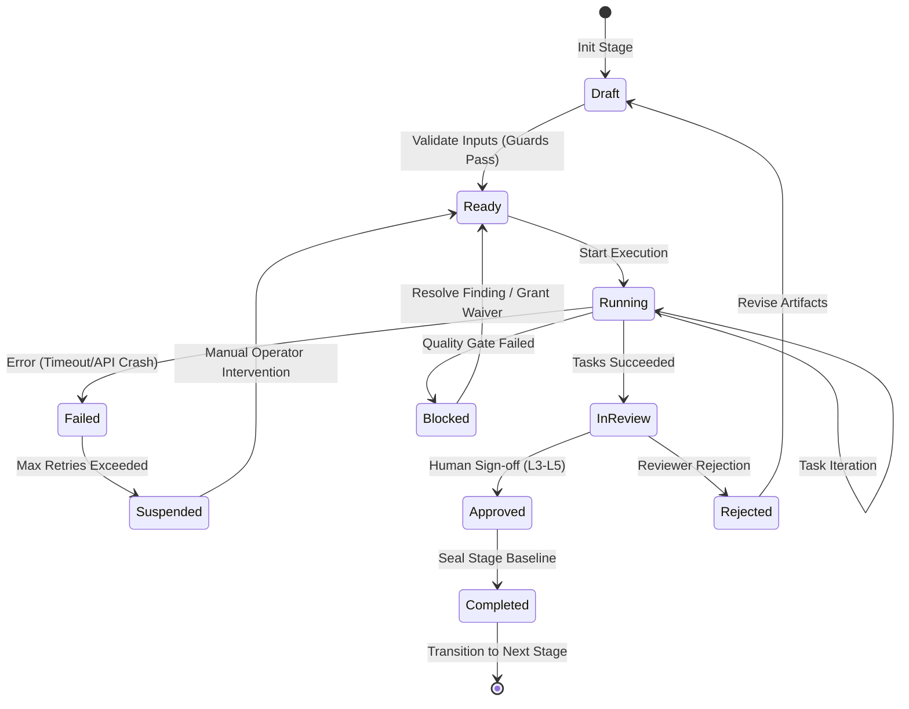

# PFS-M1-DOC-015 — Workflow Architecture & State Machines

| Thuộc tính | Giá trị |
|---|---|
| Document ID | PFS-M1-DOC-015 |
| Document Title | Workflow Architecture and State Machines Specification |
| Project | Project Foundation System (PFS) |
| Milestone | M1 — Documentation & Architecture Foundation |
| Version | 1.0.0 |
| Status | Proposed — Ready for Owner Review |
| Authority | Principal Systems Architect |
| Classification | Internal |
| Reference Architecture | Hierarchical Finite State Machine (HFSM), Saga Execution Coordinator (SEC) |
| Related Diagrams | DIA-008-workflow-state-machine.mmd, DIA-016-failure-recovery-flow.mmd |
| Related Decisions | ADR-009, ADR-015 |
| Invariant Reference | INV-02, INV-07, INV-08 |

---

## 1. Workflow Architecture Philosophy

Trong **Project Foundation System (PFS)**, quy trình tạo lập và quản trị nền tảng dự án không phải là một chuỗi kịch bản shell chạy mù quáng, cũng không phải một luồng chat tự do do AI dẫn dắt. Thay vào đó, PFS hiện thực hóa một **Động cơ Workflow Xác định (Deterministic Workflow Engine)** được bảo đảm bằng máy trạng thái hữu hạn phân cấp (Hierarchical Finite State Machine - HFSM) kết hợp với mẫu thiết kế **Saga Execution Coordinator (SEC)** trong Rust.

Mọi chuyển đổi trạng thái (State Transition) đều phải thỏa mãn 3 điều kiện tiên quyết:
1. **Transition Guards:** Biểu thức logic xác định kiểm tra điều kiện đầu vào (Preconditions) và kết quả cổng chất lượng (Quality Gates).
2. **Explicit Authority Signature:** Chữ ký số hoặc sự chấp thuận của cấp thẩm quyền L3–L5 tương ứng.
3. **Idempotency & Reversibility:** Mỗi bước chuyển đổi đều có thể thực hiện lại an toàn (idempotent) hoặc có giao dịch bồi hoàn (Compensating Transaction) khi xảy ra sự cố.

```
┌─────────────────────────────────────────────────────────────────────────────┐
│                       Workflow Engine Architecture                          │
├─────────────────────────────────────────────────────────────────────────────┤
│  Level 1: Foundation Lifecycle FSM (11 Macro Stages: Initialize -> Baseline)│
│  Level 2: Stage Execution FSM (Draft -> Ready -> Running -> Review -> Done) │
│  Level 3: Micro Task Saga (Planner -> Agent Route -> Tool Exec -> Validate) │
│  Resilience: Saga Log, Idempotency Store, Deadlock Prevention, Auto-Retry   │
└─────────────────────────────────────────────────────────────────────────────┘
```

---

## 2. Hierarchical State Machine Specification

### 2.1. Tầng 1: Vòng đời Vĩ mô (11 Macro Stages)
Vòng đời 11 giai đoạn kế thừa từ M0 (`STG-01-INIT` đến `STG-11-BASE`) được điều phối tuần tự:
- Trạng thái của một Stage vĩ mô chỉ chuyển từ `Active` sang `Completed` khi Stage đó đạt bản ghi **Approved** từ thẩm quyền phê duyệt.
- Chuyển tiếp tiến (Forward Transition): `STG-N` chỉ kích hoạt khi `STG-(N-1)` đã ở trạng thái `Completed`.
- Quay lui có kiểm soát (Controlled Rollback): Khi phát hiện thay đổi trọng yếu hoặc rủi ro nghiêm trọng ở giai đoạn sau (ví dụ: phát hiện lỗ hổng kiến trúc ở Stage 10), hệ thống cho phép tạo một **Rollback Revision Transition** quay trở lại Stage 4 kèm theo biên bản lý do và danh sách các artifacts cần cập nhật lại.

### 2.2. Tầng 2: Trạng thái Vi mô của từng Giai đoạn (Stage Execution FSM)
Bên trong mỗi Stage, tiến trình thực thi vận hành qua 12 trạng thái xác định:



---

## 3. Transition Guards and Invariant Enforcement

Mỗi cạnh chuyển trạng thái trong máy trạng thái đều được bảo vệ bởi các hàm kiểm tra logic (Guards) viết bằng pure Rust:

```rust
pub struct TransitionGuardContext<'a> {
    pub project: &'a ProjectAggregate,
    pub stage_id: StageId,
    pub actor: &'a Principal,
    pub evidence_store: &'a dyn EvidenceRepository,
    pub quality_engine: &'a dyn QualityGateEvaluator,
}

pub trait TransitionGuard: Send + Sync {
    fn evaluate(&self, ctx: &TransitionGuardContext) -> Result<GuardOutcome, GuardError>;
}

// Ví dụ Guard kiểm tra chuyển từ Running sang InReview
pub struct AllTasksCompletedWithZeroCriticalFindingsGuard;

impl TransitionGuard for AllTasksCompletedWithZeroCriticalFindingsGuard {
    fn evaluate(&self, ctx: &TransitionGuardContext) -> Result<GuardOutcome, GuardError> {
        // 1. Kiểm tra toàn bộ tasks của stage đã hoàn tất
        if !ctx.project.all_tasks_completed(ctx.stage_id) {
            return Ok(GuardOutcome::Blocked("Vẫn còn tác vụ đang chạy hoặc chưa xong".into()));
        }
        
        // 2. Kiểm tra Quality Gate không có lỗi Critical
        let gate_result = ctx.quality_engine.evaluate_stage_gates(ctx.project.id(), ctx.stage_id)?;
        if gate_result.has_critical_findings() {
            return Ok(GuardOutcome::Blocked("Tồn tại lỗi Critical vi phạm Quality Gate".into()));
        }

        Ok(GuardOutcome::Allowed)
    }
}
```

---

## 4. Saga Execution & Compensation Engine

Đối với các tác vụ dài hạn bao gồm nhiều bước có tác động ngoại vi (gọi LLM, ghi tệp vào Staging, chạy công cụ linter trong Sandbox), PFS áp dụng mẫu thiết kế **Saga Pattern**:
1. **Saga Log:** Mọi hành động thành công (Step 1, Step 2, Step 3) đều được ghi nhận vào nhật ký giao dịch liên tục (Write-Ahead Saga Log).
2. **Failure Detection:** Nếu Step 4 gặp sự cố kỹ thuật không thể phục hồi (ví dụ: Disk full, Tool crash).
3. **Compensating Transactions (Hoàn tác):** Saga Engine kích hoạt ngược thứ tự các thao tác bồi hoàn:
   - *Bồi hoàn Step 3:* Xóa bỏ các tệp tin tạm đã sinh trong Staging Directory.
   - *Bồi hoàn Step 2:* Giải phóng Task Lease của Agent.
   - *Bồi hoàn Step 1:* Đưa trạng thái thực thi về Checkpoint an toàn gần nhất.
4. **Idempotency Guarantee:** Nếu một sự kiện trùng lặp gửi đến khi Saga đang chạy, Idempotency Key sẽ chặn đứng việc thực thi lại và trả về trạng thái đang xử lý.

---

## 5. Deadlock Prevention & Concurrency Controls

Để ngăn chặn tình trạng thắt nút cổ chai (Bottlenecks) hoặc bế tắc hệ thống (Deadlocks) khi nhiều Agents chạy song song:
- **Task Lease với TTL (Time-To-Live):** Khi một Agent nhận một Task, hệ thống cấp một Task Lease có thời hạn (mặc định: 120 giây). Agent phải định kỳ gửi tín hiệu nhịp tim (Heartbeat). Nếu quá thời gian mà không có heartbeat, Lease tự động bị thu hồi và Task được chuyển cho Agent khác.
- **Hierarchical Resource Locking:** Khi cần sửa đổi các thực thể có quan hệ cha-con (Project -> Stage -> Task), hệ thống luôn thực hiện khóa tài nguyên theo thứ tự tăng dần của định danh (Lexicographical ID order), triệt tiêu hoàn toàn khả năng xảy ra Cyclic Lock Dependency.
- **Operator Override (Can thiệp khẩn cấp):** Người vận hành (Operator/Owner) có thẩm quyền L4/L5 luôn có khả năng kích hoạt lệnh `CmdForcePauseWorkflow` hoặc `CmdForceCancelTask` để giải phóng tài nguyên bị treo mà không làm hỏng tính toàn vẹn dữ liệu.
