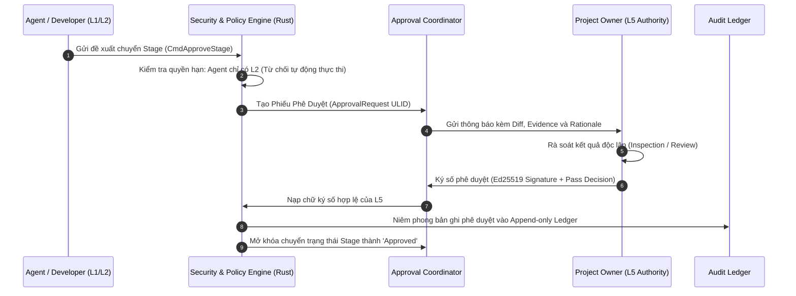

# PFS-M1-DOC-019 — Governance, Policy & Authorization Architecture

| Thuộc tính | Giá trị |
|---|---|
| Document ID | PFS-M1-DOC-019 |
| Document Title | Governance, Policy and Authorization Architecture Specification |
| Project | Project Foundation System (PFS) |
| Milestone | M1 — Documentation & Architecture Foundation |
| Version | 1.0.0 |
| Status | Proposed — Ready for Owner Review |
| Authority | Principal Systems Architect |
| Classification | Internal |
| Reference Architecture | Role-Based Access Control (RBAC), Attribute-Based Access Control (ABAC), Least Privilege |
| Related Diagrams | DIA-010-governance-approval-sequence.mmd |
| Related Decisions | ADR-014, ADR-015 |
| Parent Baseline | [PFS-M0-SPEC-005](file:///C:/Users/OK259/rust/docs/M0-foundation/05-GOVERNANCE-MODEL.md), [PFS-M0-SPEC-006](file:///C:/Users/OK259/rust/docs/M0-foundation/06-AUTHORITY-AND-DECISION-MODEL.md) |
| Invariant Reference | INV-04, INV-06 |

---

## 1. Governance Architectural Philosophy

Nguyên lý nền tảng của **Project Foundation System (PFS)** là: **"Governance Before Autonomy — Quản trị đi trước Tự hành"**. Trong kỷ nguyên các mô hình trí tuệ nhân tạo ngày càng mạnh mẽ, việc để AI tự quyết định kiến trúc, tự phê duyệt thay đổi hoặc tự cấp quyền hạn cho chính mình là nguyên nhân trực tiếp dẫn đến mất kiểm soát an ninh và thảm họa kỹ thuật.

PFS thiết lập một **Hệ thống Quản trị Xác định (Deterministic Governance System)** được thi hành tại tầng lõi Rust, bảo đảm:
1. **Explicit Delegation:** Quyền lực bắt nguồn từ sự ủy quyền rõ ràng của Project Owner; không có quyền hạn ngầm định.
2. **Deny-by-Default:** Mọi hành động truy cập, sửa đổi hoặc thực thi tài nguyên đều bị từ chối mặc định trừ khi có chính sách cho phép tường minh.
3. **Separation of Duties (SoD):** Ngăn ngừa xung đột quyền lợi; người khởi tạo/đề xuất không được phép tự phê duyệt sản phẩm của chính mình.
4. **Non-Repudiation & Cryptographic Audit:** Mọi quyết định phê duyệt đều được niêm phong bằng chữ ký số và lưu trữ bất biến.

```
┌─────────────────────────────────────────────────────────────────────────────┐
│                       Deterministic Governance Architecture                 │
├─────────────────────────────────────────────────────────────────────────────┤
│  [ Incoming Request / Command ]                                             │
│        │                                                                    │
│  Phase 1: Identification & Authentication (Principal Verification)          │
│        │ Pass                                                               │
│  Phase 2: Policy Enforcement Point (PEP) in Rust Core                       │
│        │ queries Policy Decision Point (PDP)                                │
│  Phase 3: L0–L5 Authority Evaluation & Scope Isolation Check                │
│        ├── Check Subject Role & Assigned Level (L0..L5)                     │
│        ├── Check Resource Scope (Tenant / Workspace / Project)              │
│        └── Check Separation of Duties (Actor != Proposer)                   │
│        │ Allowed                                                            │
│  Phase 4: Transaction Execution & Append-only Audit Log Emission            │
└─────────────────────────────────────────────────────────────────────────────┘
```

---

## 2. Formal L0–L5 Authorization Model (Preserved from M0)

PFS bảo toàn chính xác mô hình phân cấp thẩm quyền 6 cấp độ (L0–L5) đã được nghiệm thu tại M0:

| Mức phân quyền | Tên quyền | Định nghĩa thẩm quyền chuẩn M0 | Hành vi được phép | Chủ thể áp dụng điển hình |
|---|---|---|---|---|
| **L0** | **Read-Only** | Chỉ đọc dữ liệu / tài nguyên được cấp phép | Đọc specifications, duyệt requirements, xem artifact metadata. Tuyệt đối không thay đổi trạng thái. | Khách vãng lai, Developer mới, Agent tra cứu tài liệu. |
| **L1** | **Analyze / Propose** | Phân tích và đưa ra đề xuất | Phân tích tài liệu, đặt câu hỏi làm rõ, đề xuất giải pháp, dự thảo khuyến nghị. | Chuyên gia phân tích, AI Agents chuyên trách (Analyst, Discoverer). |
| **L2** | **Draft Artifacts** | Tạo bản nháp trong vùng được ủy quyền | Tạo tệp tin nháp trong thư mục tạm (`.pfs/staging/`), sinh dự thảo ADRs, cập nhật ghi chú cá nhân. | Technical Writers, AI Code/Doc Drafting Agents. |
| **L3** | **Modify Authorized Files** | Sửa các tệp tin được ủy quyền chính thức | Cập nhật tài liệu kiến trúc, sửa mã nguồn trong phạm vi phân công, giải quyết xung đột nhỏ. | Senior Developers, Lead Architects, Humans. |
| **L4** | **Execute Approved Operations** | Chạy script, test hoặc operation được phê duyệt | Kích hoạt bộ sinh Foundation, chạy test harness trong Sandbox, duyệt Quality Gates cấp chuyên môn. | Project Operators, QA Leads, Security Officers. |
| **L5** | **Privileged / Destructive** | Thao tác đặc quyền hoặc phá hủy, cần authorization rõ ràng | Nghiệm thu Baseline Milestone, thay đổi cấu trúc quản trị, xóa dự án, phê duyệt ngoại lệ khẩn cấp. | **Project Owner duy nhất** (hoặc Hội đồng Quản trị ủy quyền). |

> [!CRITICAL]
> **Giới hạn bất biến đối với AI Agents:** Toàn bộ AI Agents trong hệ thống PFS mặc định chỉ được cấp phát quyền tối đa ở mức **L1 (Đề xuất)** hoặc **L2 (Dự thảo nháp)**. Tuyệt đối không bao giờ cấp quyền L3, L4 hoặc L5 cho bất kỳ AI Agent nào. Mọi hành động từ L3 trở lên bắt buộc phải có sự xác nhận của Con người (Human-in-the-Loop).

---

## 3. Human Approval Workflow & Digital Signatures

Quy trình phê duyệt (Approval Workflow) được kích hoạt mỗi khi có một thay đổi vượt quá quyền hạn của người thực hiện hoặc khi workflow chạm đến các cổng chất lượng chuyển giai đoạn:



### 3.1. Cấu trúc Bản ghi Phê duyệt Hợp lệ (Approval Record)
Một quyết định phê duyệt chỉ có hiệu lực pháp lý khi thỏa mãn đầy đủ các trường dữ liệu:
- `approval_id`: Định danh duy nhất (ULID).
- `request_id`: Định danh phiếu yêu cầu phê duyệt tương ứng.
- `approver_principal`: Danh tính chủ thể ký duyệt (User ID con người).
- `authority_level_verified`: Mức thẩm quyền đã xác minh tại thời điểm ký (vd: `L5_Privileged`).
- `decision_outcome`: `Approved`, `Rejected`, hoặc `ApprovedWithConditions`.
- `target_resource_hash`: Mã băm SHA-256 của toàn bộ nội dung tài liệu/artifact được phê duyệt.
- `policy_version`: Phiên bản chính sách quản trị đang có hiệu lực.
- `signature_block`: Chữ ký số mã hóa bất đối xứng (Ed25519) của người phê duyệt.
- `timestamp`: Thời gian ký chính xác theo chuẩn UTC ISO 8601.

---

## 4. Separation of Duties (SoD) & Conflict of Interest

Hệ thống Policy Engine tích hợp thuật toán kiểm tra chống xung đột quyền lợi:
1. **Rule SoD-1 (Maker-Checker):** Chủ thể tạo ra một Requirement, một Quyết định kiến trúc (ADR) hoặc một Artifact tuyệt đối không được phép là người ký duyệt nghiệm thu chính thực thể đó.
2. **Rule SoD-2 (Auditor Independence):** Chuyên gia hoặc Agent thực hiện kiểm toán độc lập (Independent Auditor) tại Stage 10 không được phép tham gia vào việc thiết kế kiến trúc hoặc sinh mã nguồn tại Stage 4 và Stage 9.
3. **Rule SoD-3 (Waiver Authority Separation):** Ngoại lệ chất lượng (Quality Waiver) chỉ được cấp bởi cấp quản lý cao hơn cấp phụ trách trực tiếp phân hệ xảy ra lỗi.
